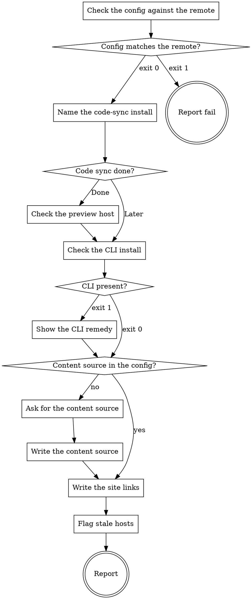

# eds-setup

The core's `setup` writes a config that is valid; this skill makes sure the platform can actually
serve this repository before the first run needs it. Each thing checked here is something a run
would otherwise discover mid-way: a preview host nothing syncs code to, a CLI the draft server
cannot find, a host name in an instruction file that points at a site that is no longer this one.

Run every script from the project root. `<config>` is `.ai/project-config.yaml`. This skill asks
only what nothing in the project can answer — whether a human finished a step outside this
session, and the content source URL. It installs nothing: a remedy is shown for the human to run,
because a tool that installs its own dependencies changes the machine it was asked to inspect.
Personal values follow `${CLAUDE_PLUGIN_ROOT}/core/personal-values.md`.

## Flow



## Node Details

### Check the config against the remote

Run `bash ${CLAUDE_PLUGIN_ROOT}/shared/scripts/check-preview-config.sh`. It re-derives the preview
host suffix and the branch limit from the current `origin` remote and compares them with the
config. Everything below builds host names from the config, so a stale config would make every
later check answer about the wrong site.

### Config matches the remote?

Exit `0` — go to **Name the code-sync install**. Exit `1` — go to **Report fail**, quoting its
stderr line verbatim: the repository moved or was renamed after setup, and the core's `setup` must
be run again with re-detect before this skill can check anything.

### Name the code-sync install

Read the owner and repository from `git remote get-url origin`. Tell the human, plainly: the
preview host serves this repository's code only once the code-sync app is installed on
`<owner>` with `<repo>` included — `https://github.com/apps/aem-code-sync` — and that a run
cannot reach a rendered page until it is. Say that it is a step only they can do, in the browser,
with the owner's admin rights. Then ask with `AskUserQuestion`: **Done** or **Later**.

### Code sync done?

**Done** — go to **Check the preview host**. **Later** — note for the report that the code-sync
step is still open and that every run will stop before intake until it is done (the pack's
`preview-host` check), then go to **Check the CLI install**.

### Check the preview host

Run `bash ${CLAUDE_PLUGIN_ROOT}/shared/scripts/check-preview-host.sh`. Exit `0`: the default
branch's preview host serves this repository's code — say exactly that, not that the site works.
Exit `1`: quote its stderr line; the app is not covering the repository yet, or nothing has been
pushed to the default branch since it was installed. Either way, go on.

### Check the CLI install

Run `bash ${CLAUDE_PLUGIN_ROOT}/core/lib/check-requires.sh platform=${CLAUDE_PLUGIN_ROOT}/pack.yaml`
and report its lines verbatim. Also read `<config>`'s `commands.serve`: when it holds `npx -y` or
`npx --yes`, say that it downloads the CLI on every start while the draft server uses only the
project's own install, and that `npm run`-style use of the local install keeps both the same.

### CLI present?

Exit `0` — go to **Content source in the config?**. Exit `1` — go to **Show the CLI remedy**.

### Show the CLI remedy

Show the `missing:` line's remedy as the command for the human to run, and say why it is asked
now: the draft server stops without it, and installing it during a run changes tracked files the
run then refuses to publish. Never run it yourself. Note it for the report as open.

### Content source in the config?

Read `platform.content_source` from `<config>`. Present — show it and go to **Write the site
links**. Absent — go to **Ask for the content source**.

### Ask for the content source

Ask with `AskUserQuestion` for the URL where this site's content is authored — the folder or
editor the content source points at; nothing in the repository holds it. Offer **Skip** as an
option. An answer that is not an `https://` URL with no spaces is asked again once; a second one,
or Skip, means no content source: go to **Write the site links** with nothing written.

### Write the content source

Write a file `.ai/run-context/platform-values.txt` holding one line,
`platform.content_source=<url>`, and run
`bash ${CLAUDE_PLUGIN_ROOT}/core/lib/write-run-config.sh <config> --derived .ai/run-context/platform-values.txt`.
Report its output verbatim. It keeps every other value in the file; never edit the config by hand.

### Write the site links

Run `bash ${CLAUDE_PLUGIN_ROOT}/shared/scripts/write-site-links.sh` and report its line. It writes
the content editor, preview and live links into one marked block of the project README from the
config; the preview and live links are derived from the suffix, never stored. Nothing about who
may edit the site belongs in the repository, so nothing else is written.

### Flag stale hosts

Run `bash ${CLAUDE_PLUGIN_ROOT}/shared/scripts/check-instruction-hosts.sh` and report every
`stale:` line verbatim. Do not edit those files: an instruction file is the project's own text,
and which host it should name is the human's change to make. Say that a run reading such a file
may be pointed at a site that is no longer this one.

### Report fail

```
bash ${CLAUDE_PLUGIN_ROOT}/core/lib/emit-envelope.sh .ai/run-context/envelope-eds-setup.txt \
  --verdict fail --summary "<the stale value, quoted from check-preview-config.sh>"
```

Then end with that envelope's `## Result` block, unchanged.

### Report

State, per step: the config check; the code-sync step (done and proven, done but the host did not
answer, or later); the CLI (present, or the remedy still to run); the content source (kept, written
or skipped); the README (created, updated, unchanged); each stale host. Then:

```
bash ${CLAUDE_PLUGIN_ROOT}/core/lib/emit-envelope.sh .ai/run-context/envelope-eds-setup.txt \
  --verdict <pass|warn> --summary "<one sentence, at most 200 characters>" [--artifact <path>]…
```

`pass` only when the host answered, the CLI is present and no host is stale; otherwise `warn`,
naming the first open step. Artifacts: the README and the config when this skill changed them.
End with that envelope's `## Result` block, unchanged.
